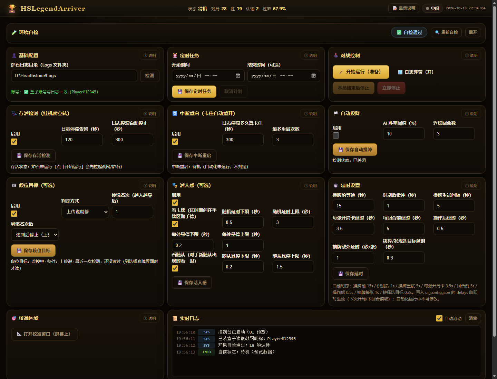

<div align="center">

# 🏆 HSArriver-Turbo

### 炉石传说 · 盒子推荐驱动的自动对战控制台

**原生单窗口 · 无 OCR · 读盒子 CEF / Power.log · 自动执行操作**

当前版本：**1.3.16** ｜ 仅支持 **Windows 10/11 64 位**

</div>



> 界面示意：实际数值以你的机器为准。顶部是状态栏，下面依次是基础配置、定时任务、对战控制、存活检测、中断重启、自动投降、段位目标、活人感、延时设置、校准区域和实时日志。

---

## 这个项目是什么

它不是"用 OCR 看屏幕猜牌"的脚本，而是一个**日志 + 盒子数据驱动**的自动对战控制台：

```text
Power.log ───────────────► 牌局状态 / 手牌 / 场面 / 回合
                                  │
HSAng 盒子（CDP 9222）───► 推荐 JSON、AI 胜率、传说名次、当前战网昵称
                                  │
                            FSM 状态机
                                  │
                     click.py / 贝塞尔轨迹 / 人类化延时
                                  ▼
                          炉石传说客户端
```

- **推荐、AI 胜率、传说名次**：直接读盒子 CEF 页面推送的 JSON，不再截图做 OCR。
- **自己的战网昵称**：自动从盒子首页 `client-home` 读取，不需要手填用户 ID。
- **牌局状态**：来自炉石 `Power.log`，比截图像素更稳定。
- **界面判定**：只保留少量截图模板/颜色判断（例如结算按钮、进入对战），不再安装 RapidOCR / PaddleOCR / ONNX Runtime。

旧的 OCR 链路已移除，`requirements.txt` 里没有 OCR 引擎。

---

## 主要功能

| 功能 | 说明 |
|---|---|
| **按盒子推荐出牌** | 读取 `ladder-opp` 的推荐 JSON，映射成打随从、法术、武器、英雄、地标、攻击、英雄技能、星舰、发现/抉择等操作 |
| **自动开打 / 停止** | 控制台「开始运行（准备）」→「开始对战」；支持「本局结束后停止」「立即停止」和 `Ctrl+Q` |
| **账号自动识别** | 盒子首页读取完整战网昵称，换账号约 20 秒内自动跟进；日志里读到玩家名后自动校验 |
| **存活检测** | 默认开启：炉石进程消失 / 对局中 `Power.log` 长时间不动时告警并停止，避免对着失效画面空转 |
| **中断重启（可选）** | 日志停滞超过阈值时自动重启炉石并重新进入对战，带重启次数上限，默认关闭 |
| **自动投降（可选）** | 盒子 AI 胜率连续低于阈值时，自动「齿轮 → 认输」 |
| **段位目标 / 控分（可选）** | 上传说即停，或名次比目标更靠前时开局投降，压到目标后再正常打 |
| **活人感（可选）** | 随机延时、手牌区悬停、对手新随从悬停；只移动鼠标，不点击 |
| **延时设置** | 换牌、识别后缓冲、重试、每回合、抽牌、抉择目标等逐项可调，运行中可热改 |
| **校准区域** | 一次校准，拖动炉石窗口后区域自动跟随；支持 12 个目标的框选 |
| **实时日志 / 浮窗** | 主窗口实时日志；另有一个可折叠的置顶日志浮窗，显示战绩、账号、存活状态和延时进度 |
| **命令行 hsctl** | 零第三方依赖的薄客户端，给本机 agent / 远程编排用 |

---

## 环境要求

| 项 | 要求 |
|---|---|
| 系统 | Windows 10 / 11，64 位 |
| 权限 | **必须管理员运行**。否则鼠标点击会被系统拦掉，表现为「脚本在跑但没反应」 |
| 炉石 | 客户区保持 **16:9**，建议全屏；不要用"最大化窗口"代替全屏。脚本已声明 DPI 感知，缩放 100%–175% 都可以 |
| 盒子 | 简体中文版炉石盒子，登录当前战网账号；需要带 `--remote-debugging-port=9222` 启动（程序会自动处理） |
| WebView2 | 单窗口模式需要 Windows 10/11 自带的 **WebView2 Runtime**；缺失时会退回浏览器页面 |
| Python（仅源码运行） | **3.12 64 位**；依赖见 `requirements.txt` |
| 路径 | 不建议把项目放在含中文字符的路径下（部分依赖对中文路径兼容性差） |

> 盒子默认路径是 `D:\炉石传说盒子\HSAng.exe`。不在默认位置时，用环境变量 `HSA_BOX_EXE` 指向实际 `HSAng.exe`，或在 `ui_config.json` 的 `box.exe` 里配置。

---

## 快速开始（exe 单文件版）

产物：`dist\HSArriver-Turbo.exe`（约 209 MB，内含 Python 3.12 和全部依赖）。

1. **先清理旧实例**：任务管理器（管理员）结束所有旧的 `pythonw.exe`，或重启一次。旧版本没有单实例保护，重复启动会留下多个后台进程。
2. 双击 `HSArriver-Turbo.exe`。首次会解压到：
   ```text
   %LOCALAPPDATA%\HSArriverTurbo\runtime-1.3.16
   ```
   约 524 MB，首次 1–3 分钟；之后几秒启动。
3. 弹出 UAC 时点「是」。启动后只打开**一个原生窗口**，不是浏览器标签页。
4. 在「👤 基础配置」里填炉石日志目录（例如 `D:\Hearthstone\Logs`），点「检测」。
5. 第一次使用先点「📐 打开校准窗口（屏幕上）」，对齐后按 **S** 保存，按 **Esc** 退出。
6. 确认盒子已登录，点「🪄 开始运行（准备）」，确认浮窗账号匹配；再点「⚔️ 开始对战」。

**窗口行为：**

- **关闭窗口 = 退出整个进程**（自动化、日志浮窗、后台线程一起结束）。
- 想暂时收起界面，用**最小化**，不要关闭。
- 重复双击只会聚焦已有窗口，不会起第二个实例。
- 日志写入 `app\log\console.log`；实际端口在 `app\log\ui_port.txt`。

---

## 源码运行

```powershell
# 建议在项目根目录创建虚拟环境
py -3.12 -m venv .venv
.\.venv\Scripts\Activate.ps1

pip install -r requirements.txt -i https://pypi.tuna.tsinghua.edu.cn/simple
python web_ui.py
```

必须用**管理员 PowerShell**启动。默认打开单窗口；窗口关闭即退出。

开发/无头调试：

```powershell
python web_ui.py --no-browser        # 只起 HTTP 服务，不打开窗口
python web_ui.py --new-instance      # 绕过单实例检查（调试用）
```

`--no-browser` 下用浏览器访问 `http://127.0.0.1:8765`（端口占用会顺延到 8785，以 `log\ui_port.txt` 为准）。

### 让启动不再弹 UAC（可选）

```powershell
# 管理员 PowerShell 里执行一次
python hsctl.py serve install-task

# 之后普通窗口 / agent 直接启动
python hsctl.py serve start --via-task
```

细节见 [`docs/CLI.md`](docs/CLI.md)。

---

## 第一次使用怎么配

### 1. 日志目录

只填炉石安装目录下的 `Logs` 文件夹，例如 `D:\Hearthstone\Logs`。
用户 ID 不需要填：程序从盒子首页自动读取当前战网完整昵称（如 `Player#12345`），换账号后自动更新。

### 2. 校准

点「🎯 校准区域」→「📐 打开校准窗口（屏幕上）」：

- 窗口显示当前目标框、屏幕中央目标条和右侧推荐区域预览；
- **Tab** 切换目标，拖框/拖边/拖右下角缩放；
- **S** 保存到 `ui_config.json`，**Esc** 退出；
- 只画当前目标，框外的画面鼠标穿透，不挡炉石操作。

自动化真正用到的是 **4（结算「开始」）/ 6（传统对战）/ 7（选择套牌标题）/ 8（9 个卡组）/ 9–12（模式点击点）**；1/2/3/5 号框仅保留框位预览，不再参与推荐、换牌确认、AI 胜率和名次识别。

### 3. 盒子调试端口

推荐、AI 胜率、名次和账号都走盒子 CEF，所以盒子必须带 `--remote-debugging-port=9222` 运行。

一般**不用手动开**：`hsctl prepare` 或页面「开始运行（准备）」会检查盒子；没开就带参数启动，开着但没端口就重启（对局中会拒绝，打完再重启）。

验证：

```powershell
curl http://127.0.0.1:9222/json/list
```

能看到 `client-home`、`ladder-opp`、`winrate-predict` 等页面即可。

### 4. 开始运行

- **🪄 开始运行（准备）**：打开日志浮窗、确保盒子带端口、把炉石切到前台，但**不会自动开打**。
- 确认浮窗「账号」显示匹配（账号来自盒子，不匹配就检查盒子登录的账号）。
- **⚔️ 开始对战**：开始按推荐执行。停止用「立即停止」或 `Ctrl+Q`。

---

## 界面说明

当前界面是**三列紧凑布局**，尽量一屏显示：

- **顶部状态栏**：状态、对局数、胜场、认输数、胜率、状态灯、时钟。
- **环境自检**：通过时自动折叠成一行 ✅；有 ❌ 时自动展开。右上角可重新自检。
- **基础配置**：炉石日志目录、当前盒子账号校验。
- **定时任务**：到点开始/结束；结束会等本局打完再停。
- **对战控制**：开始运行/开始对战、日志浮窗、本局结束后停止、立即停止。
- **存活检测**：默认开启；进程消失或日志停滞时告警并停止。
- **中断重启**：默认关闭；日志停滞时重启炉石，带次数上限。
- **自动投降 / 段位目标**：按 AI 胜率或传说名次执行；默认关闭。
- **活人感 / 延时设置**：鼠标行为与节奏参数；运行时部分可热改。
- **校准区域 / 实时日志**：区域校准和滚动日志。

说明文字默认收起：右上角「📝 显示说明」全局展开；每张卡片右上角「ⓘ 说明」单独展开。

---

## 命令行 hsctl

`hsctl.py` 只调用本地 JSON 接口，不碰 FSM / 浮窗逻辑；网页（窗口）仍是唯一状态源。

```powershell
python hsctl.py --json doctor     # 环境 / 控制台 / 提权 / 下一步
python hsctl.py status            # 阶段、账号匹配、战绩、参数
python hsctl.py prepare           # 准备：盒子带端口 + 浮窗 + 炉石前台
python hsctl.py start             # 开始对战
python hsctl.py stop --after-game # 打完本局再停
python hsctl.py stop              # 立即停
python hsctl.py box               # 检查/启动盒子（可 --restart）
python hsctl.py config set --log-root "D:\Hearthstone\Logs"
python hsctl.py delays set pre_action_delay_seconds=5
python hsctl.py watchdog set --stale 300 --max-restarts 3
python hsctl.py concede set --enabled --threshold 12 --rounds 4
python hsctl.py serve start       # 后台拉起控制台
```

完整命令、退出码和无人值守说明见 [`docs/CLI.md`](docs/CLI.md)。给 agent 的速查见 [`SKILL.md`](SKILL.md)。

---

## 虚拟机 / 无人值守

可以做到「无人值守 + 主窗口最小化」，但**不能让炉石最小化，也不能没有桌面会话**：

- 必须保持 Windows 已登录、未锁屏；关闭屏保/睡眠。
- 炉石必须保持前台、全屏/16:9、未被最小化：截图和鼠标点击都依赖真实桌面。
- 虚拟机里建议自动登录 + 任务计划「登录时」以最高权限启动 exe；启动后可以把主窗口最小化（不要关闭）。
- 宿主机上的 VM 控制台窗口可以最小化；guest 内不能锁屏。
- 不要直接断开 RDP（会锁会话）；需要远程看画面用 VM 控制台/VNC，或 `tscon <会话> /dest:console` 切回控制台并保持解锁。
- 当前**不支持**「炉石最小化/无头运行」；那需要重写为后台窗口截图 + 消息点击，Hearthstone 最小化后通常不渲染，成功率低。

---

## 常见问题

| 现象 | 处理 |
|---|---|
| 双击后没有窗口 | 看 `app\log\console.log`；确认 WebView2 Runtime 存在。可先用 `python web_ui.py --no-browser` 验证后端 |
| 提示已有实例但看不到窗口 | 旧实例可能没有原生窗口：管理员任务管理器结束所有 `pythonw.exe`，或重启 |
| 仍有很多 `pythonw.exe` / 端口 8765–8770 | 旧版本没有单实例保护，是之前重复启动留下的；杀掉/重启后只用 1.3.16 |
| 点了没反应 | 没有管理员权限；用管理员 PowerShell 或计划任务启动 |
| 盒子没有调试端口 | 运行 `python hsctl.py prepare` 或 `python hsctl.py box --restart`；对局中先打完 |
| 账号不匹配 | 盒子登录的不是当前战网账号；在盒子里重新登录，约 20 秒自动更新 |
| 一直提示「推荐暂不可执行」 | 看日志里的 `[推荐] 原文` JSON；把那段贴出来排查 |
| 日志目录不存在 | 「基础配置」里点「检测」，或 `hsctl config set --log-root ...` |
| 关闭窗口后自动化停了 | 这是设计行为：关闭 = 退出整个进程；要挂机请用最小化 |
| 解压报「访问被拒绝」 | 换一个有写权限的目录；不要放在受控/只读目录，必要时用 `--home` 指定 |
| 首次启动很慢 | 首次解压约 524 MB，之后启动只需几秒 |

---

## 配置、隐私与发布

- 本机配置在 `ui_config.json`：日志目录、盒子路径、延时、活人感、校准坐标等。它已被 `.gitignore` 忽略，**不会进仓库**。
- 解释器路径等环境信息在 `log/env.json`（同样忽略）；仓库只有占位符 `env.example.json`。
- 控制台只监听 `127.0.0.1`，自停接口需要 `log/ui_port.txt` 里的 token；不要做公网端口转发。
- 仓库和发布产物**不包含代码签名证书/私钥**。exe 未签名，Windows 可能提示「未知发布者 / SmartScreen」；正式发布请使用 CA 证书或 Microsoft Trusted Signing。
- 本机构建的 `dist` 包可能含 `ui_config.json`（私人日志路径等），**不要上传到公开 Release**；公开版请在干净仓库重新打包。
- 许可证：GPL-3.0，见 [LICENSE](LICENSE)。

---

## 从源码打包

```powershell
# 先改 build\launcher\Launcher.cs 里的 Version（例如 1.3.17）
powershell -ExecutionPolicy Bypass -File build\build-exe.ps1
```

输出：`dist\HSArriver-Turbo.exe` 和 `dist\HSArriver-Turbo.exe.sha256`。
打包脚本会把 `.venv` 的 CPython、依赖和项目源码压进单文件 exe，首次运行解压到 `%LOCALAPPDATA%\HSArriverTurbo\runtime-<版本>`。

测试：

```powershell
python -m unittest discover -s tests
```

---

## 目录结构

```text
web_ui.py              控制台后端 / HTTP API / 自动化线程 / 单实例
desktop_window.py      原生 WebView2 单窗口
web/index.html         控制台页面（三列紧凑 UI）
FSM_action.py          对战状态机
click.py               鼠标点击、贝塞尔拖动、人类化轨迹
log_state.py           Power.log 解析
src/recommendation/    盒子 CEF 推荐 / 胜率 / 名次 / 账号来源
hsctl.py               命令行客户端
log_overlay.py         置顶日志浮窗
calibrate_roi.py       区域校准
build/                 打包脚本和启动器
dist/                  本机构建产物（不入库）
tests/                 单元测试
docs/                  CLI、CDP 链路、截图
```

---

## 致谢与声明

- 感谢炉石盒子提供推荐数据；本项目只做本地读取和自动操作，不修改游戏文件。
- 仅用于技术研究与代码交流；使用自动化脚本可能违反游戏服务条款，账号风险由使用者自行承担。
- 本项目为 GPL-3.0 开源项目，不提供任何形式的担保。
- 仓库地址：<https://github.com/hyman-wang/lushi_auto>
